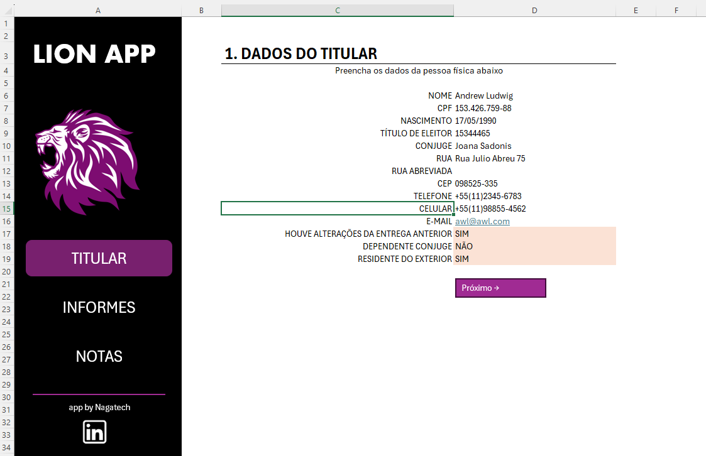
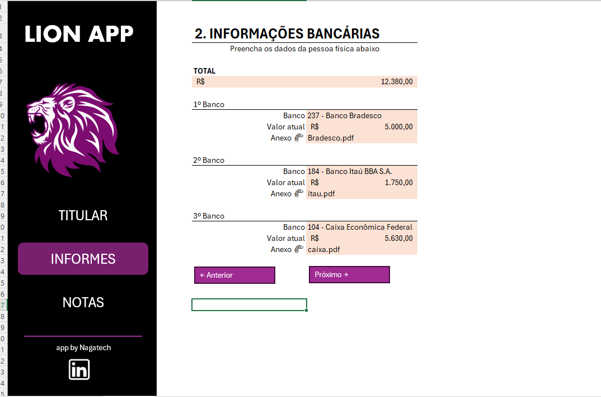
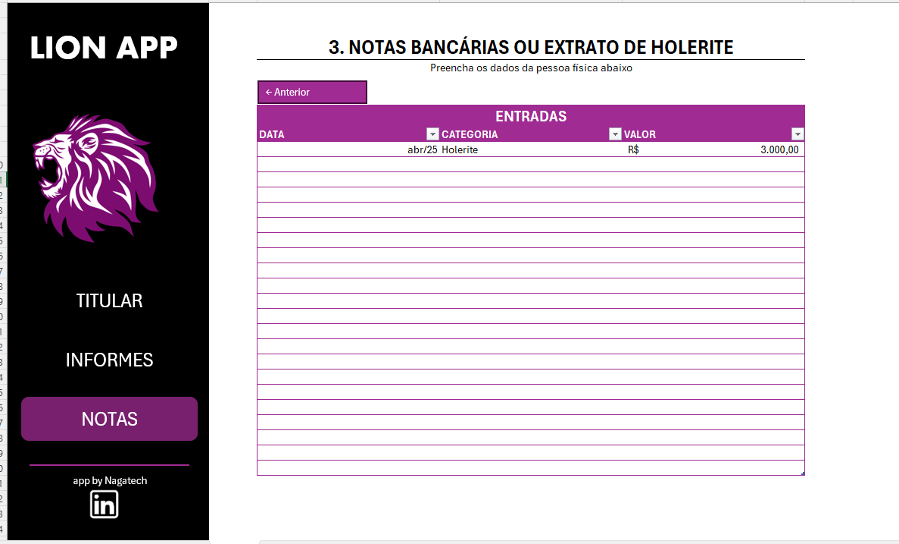
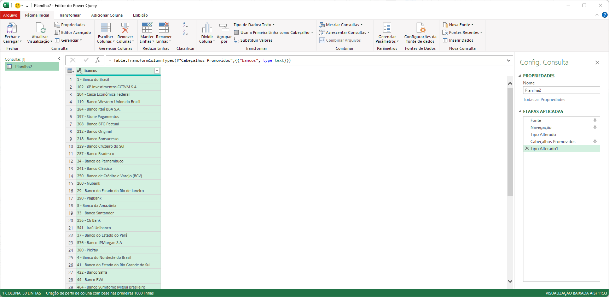
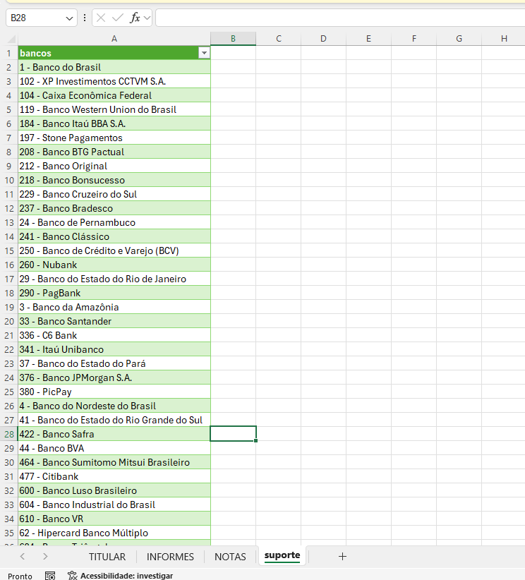
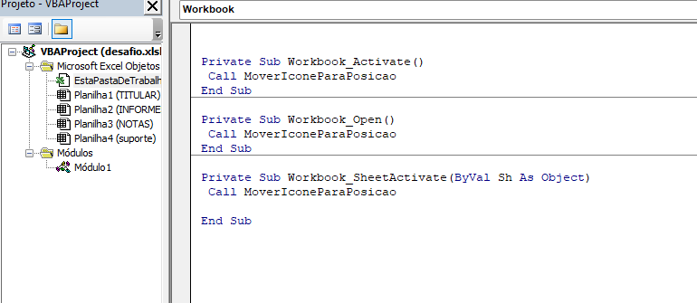
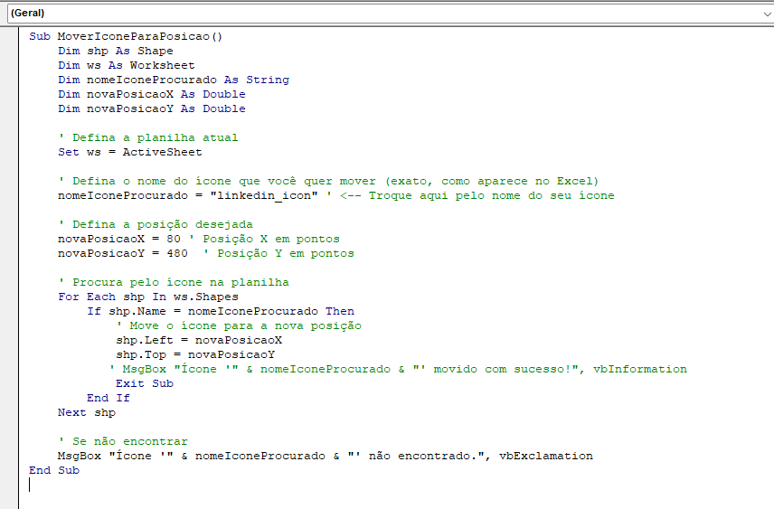

# Lion App — Organizador para a declaração de Imposto de Renda

O **Lion App** é uma ferramenta desenvolvida no Microsoft Excel para ajudar a organizar e reunir informações importantes para a declaração de Imposto de Renda. A planilha centraliza dados do titular, informações bancárias e registros de entradas em uma interface com navegação entre seções.

## Funcionalidades

- Cadastro de dados do titular, como identificação e informações de contato.
- Registro de bancos e respectivos valores, com espaço para indicar documentos anexos.
- Organização de entradas, como valores identificados em notas bancárias ou holerites, por data, categoria e valor.
- Navegação entre as telas por meio de menus e botões.
- Recursos de automação em VBA e consulta de dados de bancos com Power Query.

## Como usar

1. Abra o arquivo [`desafio.xlsb`](./desafio.xlsb) no Microsoft Excel.
2. Se necessário, habilite macros somente se confiar no arquivo e na origem dele. Os recursos de automação dependem do suporte a macros do Excel.
3. Preencha as seções **Titular**, **Informes** e **Notas**, usando os botões de navegação para avançar ou voltar entre as telas.
4. Revise os dados e mantenha os documentos comprobatórios organizados junto à planilha.

> A planilha é um apoio para organização de informações; ela não substitui a conferência dos documentos nem a orientação de um profissional contábil.

## Telas da ferramenta

| Titular | Informes bancários | Notas e entradas |
| --- | --- | --- |
|  |  |  |

## Consulta e exibição de bancos

O **Power Query** é utilizado para carregar e preparar a lista de bancos na planilha de suporte. Essa planilha permanece oculta durante o uso normal da ferramenta e serve como fonte de dados para a tela **Informes**.

A tabela abaixo representa a base de bancos mantida na planilha de suporte. Na tela de informações bancárias, a função **PROCV** consulta essa base para localizar e exibir o banco correspondente à opção informada.

## Posicionamento automático do ícone do LinkedIn

O código VBA chama a rotina de reposicionamento ao abrir o arquivo, ativar o arquivo e trocar de planilha. Assim, o ícone do LinkedIn é reposicionado automaticamente a cada troca de tela e permanece na posição definida na interface.

A macro procura o ícone pelo nome (`linkedin_icon`) e ajusta suas coordenadas na planilha ativa, mantendo o elemento visual alinhado no mesmo local durante a navegação.

## Tecnologias

- Microsoft Excel (`.xlsb`)
- VBA para automações e navegação
- Power Query para consulta e preparação de dados bancários
